# Sanad

Certificates that carry their own signature: course certificates and badges as W3C Verifiable Credentials 2.0,
checked offline, in a browser or through a Telegram bot.

[](https://www.bestpractices.dev/projects/16669)
[](https://scorecard.dev/viewer/?uri=github.com/wonmortech/sanad)
[](https://github.com/wonmortech/sanad/actions/workflows/ci.yml)
[](https://developer.mozilla.org/en-US/observatory/analyze?host=sanad.wonmor.io)
[](https://www.ssllabs.com/ssltest/analyze.html?d=sanad.wonmor.io)

**[Website](https://sanad.wonmor.io) · [Live demo](https://wonmor.io/demo/sanad/) · [Plan](docs/PLAN.md) · [Releases](https://github.com/wonmortech/sanad/releases)**

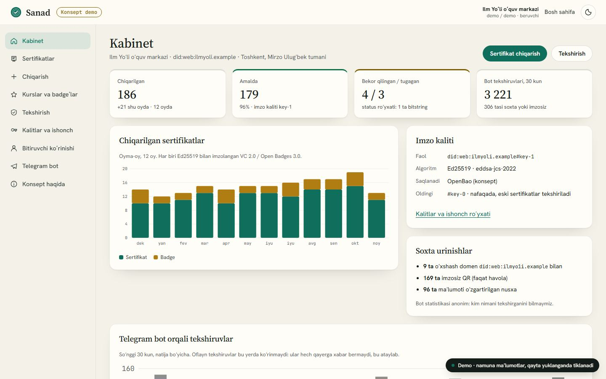

> **Status: planning.** There is no issuer, bot or issued credential yet. The [live demo](https://wonmor.io/demo/sanad/)
> is the planned product UI on fictional data: every credential in it is signed with a real Ed25519 key in your
> browser and every check re-verifies that signature. did:web resolution, the status list server, PDF/QR rendering
> and the bot are simulated.

## What it does

- **Signs, not links.** A QR code is only an address; forgers already built a lookalike "verification site"
  ([gov.uz, 2024-07-08](https://gov.uz/en/yoshlar/news/view/15837)). Change one letter of a Sanad certificate and the check fails.
- **Open standards.** [VC 2.0](https://www.w3.org/TR/vc-data-model-2.0/), Data Integrity (`eddsa-jcs-2022`),
  [Open Badges 3.0](https://www.imsglobal.org/spec/ob/v3p0/), `did:web`, [Bitstring Status List](https://www.w3.org/TR/vc-bitstring-status-list/).
- **Offline verification.** The issuer's key is cached; only the optional revocation check goes online, and it never tells the issuer which certificate was checked.
- **Three answers.** Genuine, forged (data changed, unknown key, or a lookalike issuer), or revoked / expired.
- **Batch issuing.** A training centre uploads a CSV, Sanad signs one credential per graduate and renders a printable PDF with the credential in a QR code.
- **Coinless.** No token, no blockchain payments, no custody. Issue dates can be anchored in sister project [Muhr](https://muhr.wonmor.io).

## Screenshots

| | |
|---|---|
| 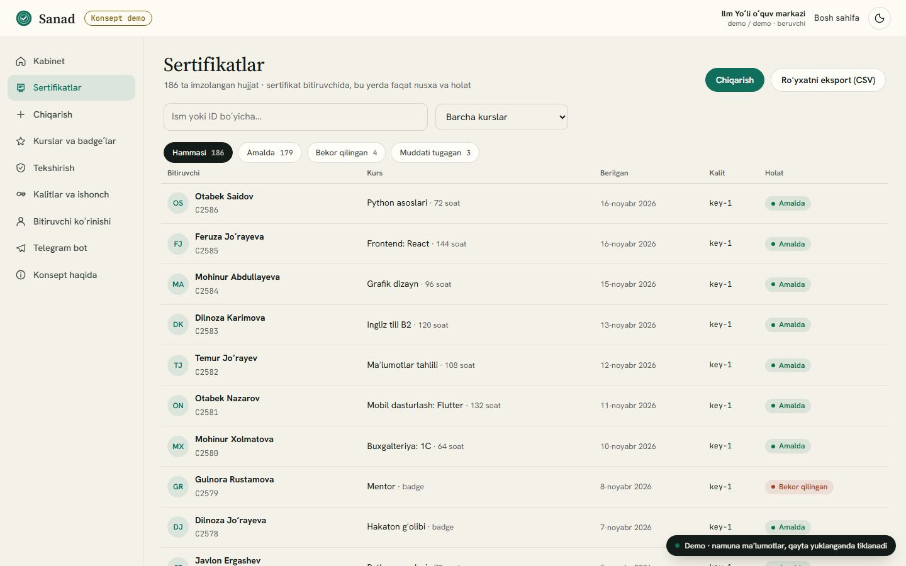 | 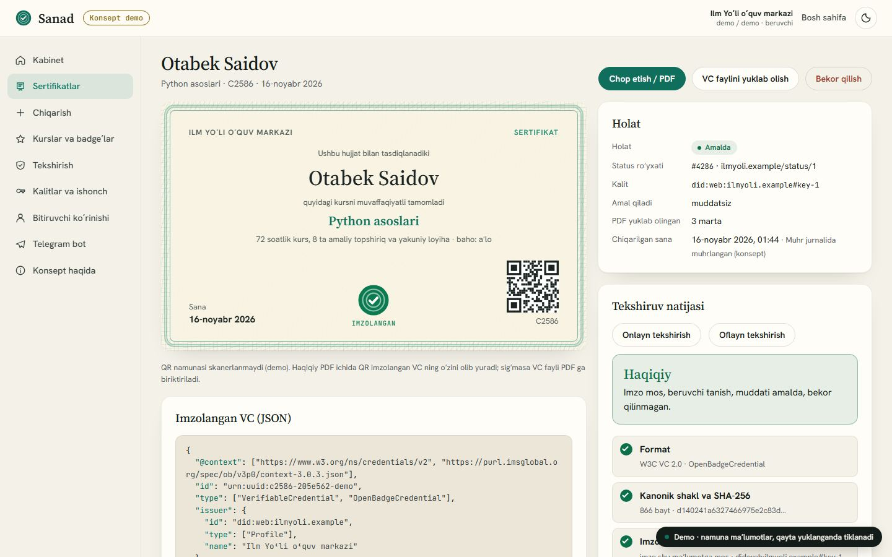 |
| Every issued credential, filtered by state and course, 25 per page. | One certificate: printable paper, the signed JSON, and a live online/offline check. |
| 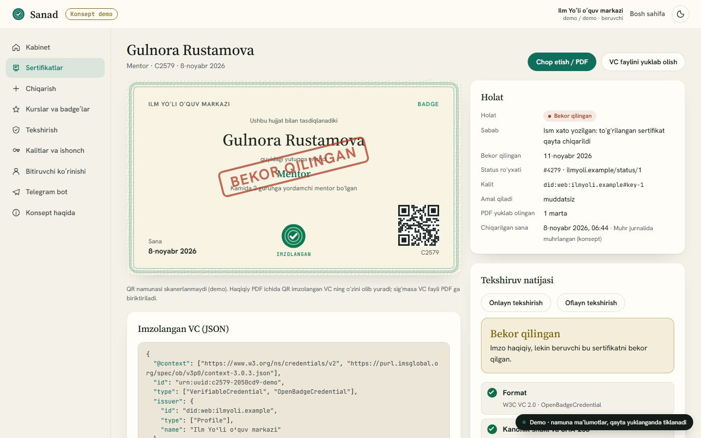 | 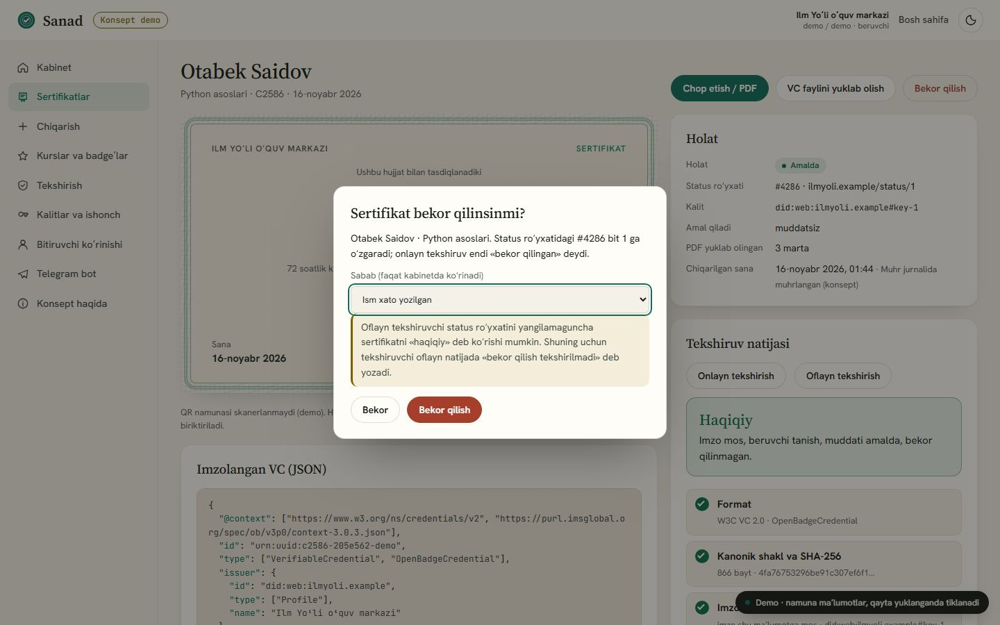 |
| A revoked certificate: the signature is still genuine, the status list says no. | Revoking flips one bit in the status list. |
| 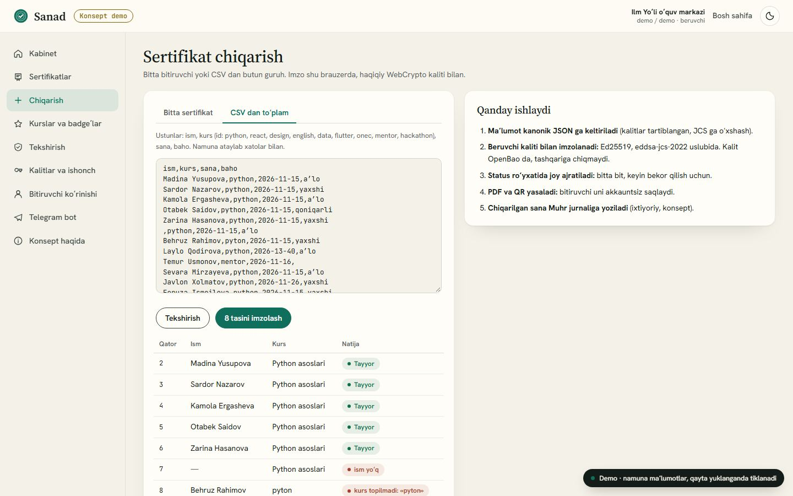 | 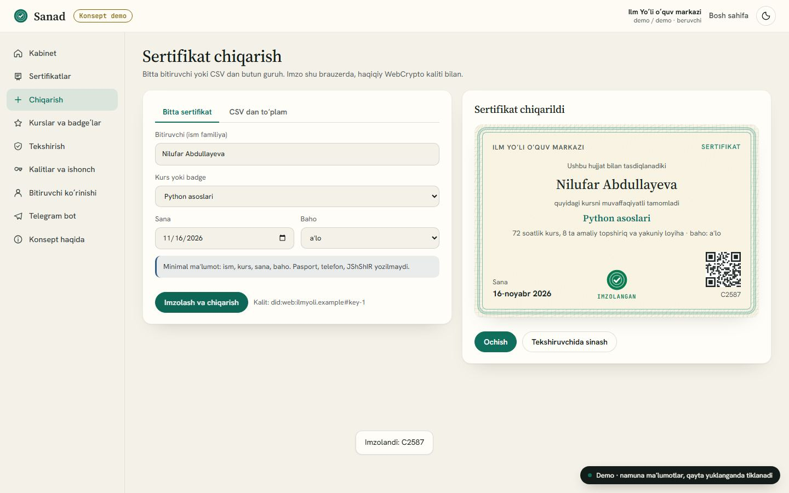 |
| A CSV batch is checked row by row before anything is signed. | One certificate signed in the browser. |
| 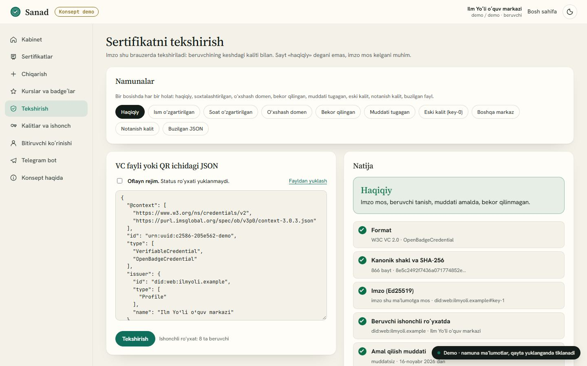 | 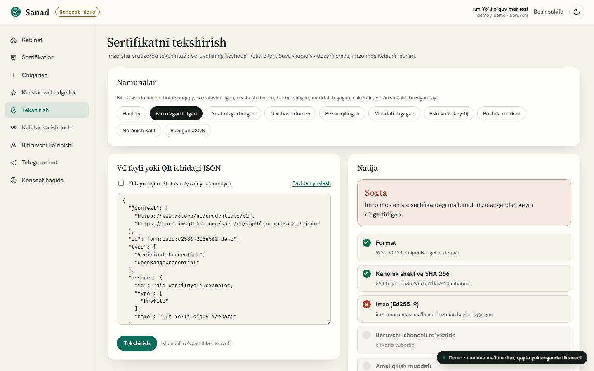 |
| The verifier: format, canonical hash, signature, trust list, validity, revocation. | One changed name and the signature no longer matches. |
| 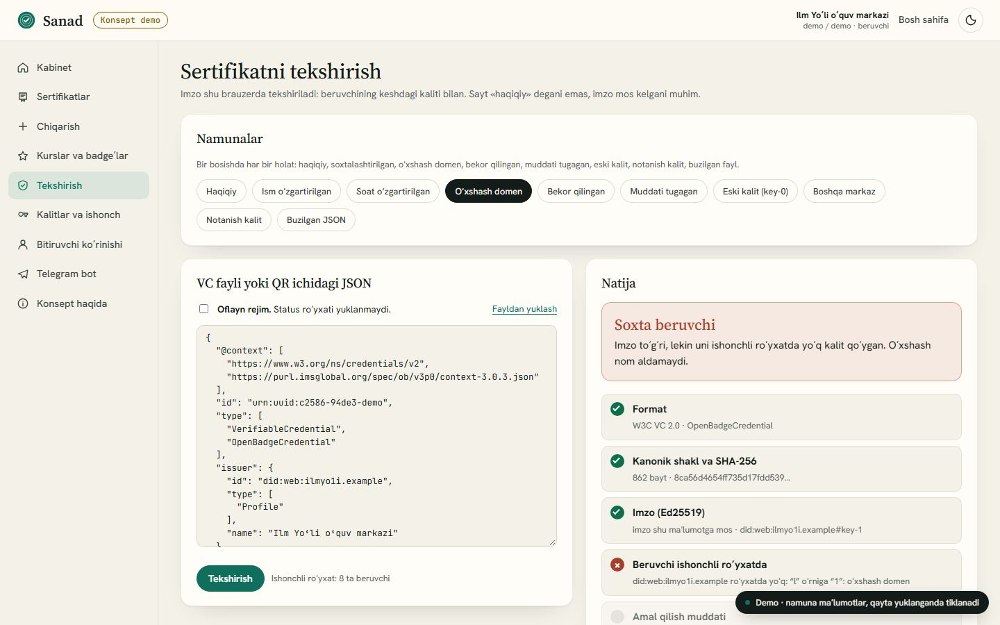 | 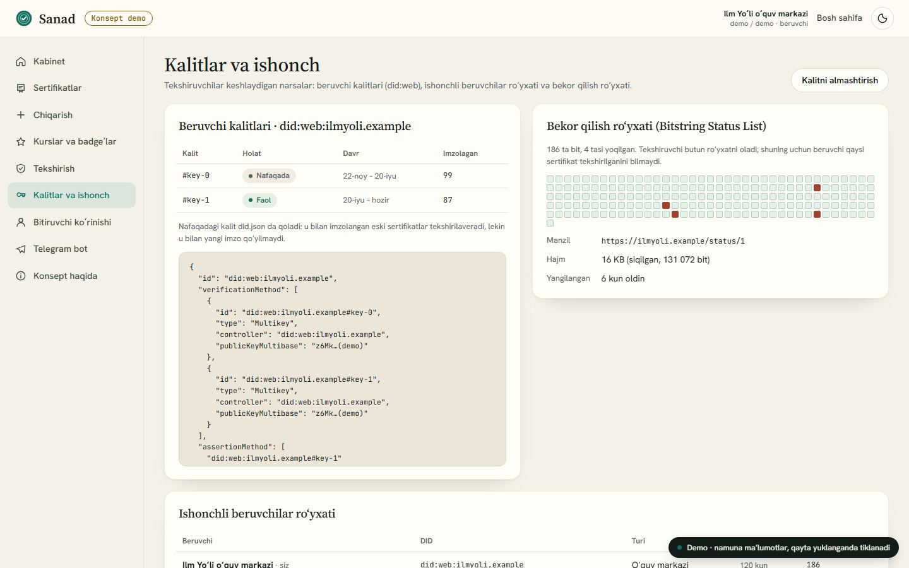 |
| A valid signature from a lookalike domain is still a fake issuer. | Key rotation, the did:web document, the revocation bitstring and the trust list. |
| 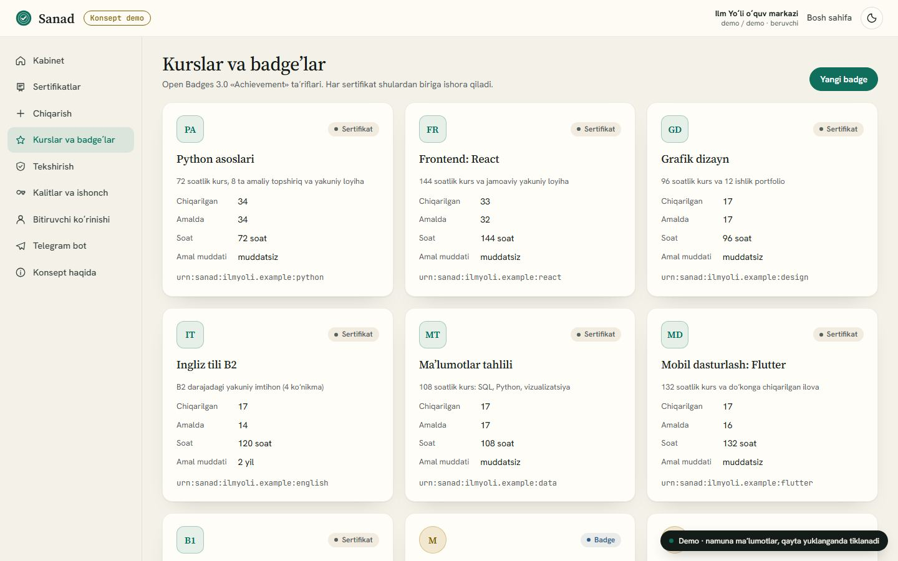 | 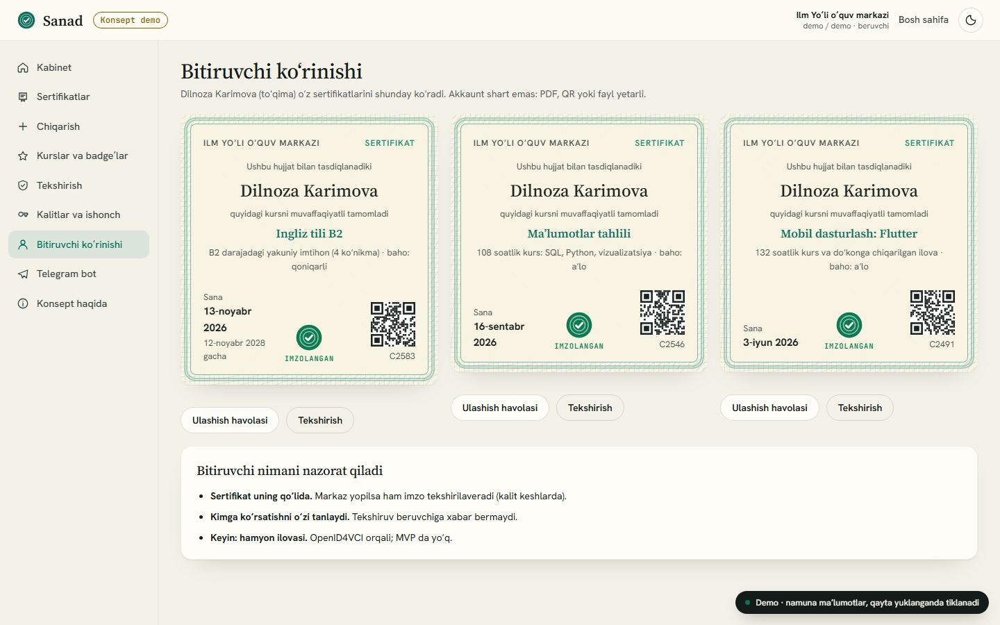 |
| Open Badges 3.0 achievements: courses and badges. | What a graduate keeps: no account needed. |
| 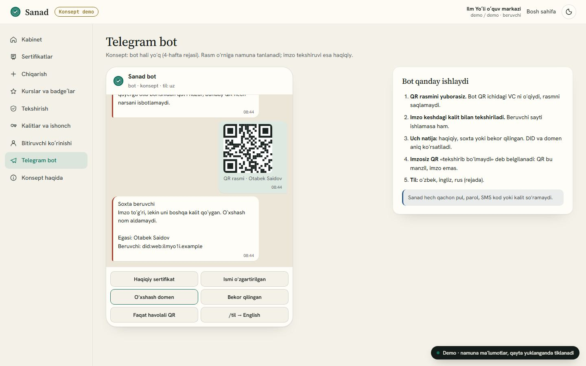 | 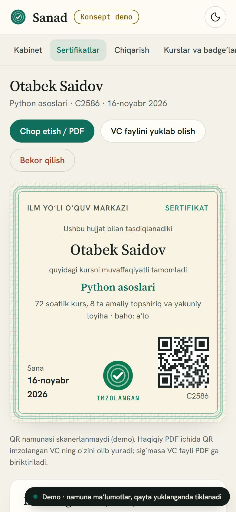 |
| The planned Telegram bot, including a QR that holds only a link. | A certificate on a phone. |

## How it will work

1. **Issue.** A training centre uploads its graduates (CSV). Sanad signs one credential per graduate with the
   centre's key, published at `did:web:<centre-domain>`, and renders a printable PDF with the credential in a QR code.
2. **Hold.** The graduate keeps the PDF, the QR or the file. No account and no website are needed to keep it valid.
3. **Verify.** An employer sends a photo of the QR to the Telegram bot or opens the web verifier. The signature is
   checked against the issuer's cached key, on the device. Only the optional revocation check needs the network.

**What it is not:** not a replacement for state diplomas or IDs (private issuers only), not a qualified electronic
signature under Uzbek law (ZRU-793), and the signature proves who issued the certificate, not what the holder knows.

## Try the demo locally

```sh
npm ci --no-audit --no-fund && npm run demo   # http://127.0.0.1:4174/demo/sanad/
```

Keys are generated fresh on every load and never leave the browser; changes stay in memory and reset on reload.

## Docs

- [Plan](docs/PLAN.md): goals, architecture, the 8-week MVP, pilots, risks, open questions
- [Research](docs/research/) (Uzbek): competitors, references, inspiration, legal notes
- [Design direction](DESIGN.md) · [Assurance case](docs/ASSURANCE.md)
- [Security](SECURITY.md) (private reports, [verifying a release](SECURITY.md#verifying-a-release)) ·
  [Governance](GOVERNANCE.md) · [Changelog](CHANGELOG.md)

Questions and ideas: [GitHub issues](https://github.com/wonmortech/sanad/issues). Vulnerabilities: not in public,
see [SECURITY.md](SECURITY.md). Wonmor will never ask you for money, passwords or keys.

## Development

`site/` is the home page (https://sanad.wonmor.io): static, no build step, strict CSP. `demo/` is the concept demo;
`tools/build-demo.mjs` copies it with the shared signing core (`site/assets/js/sanad-core.js`) into `dist/demo/sanad/`
and never touches `site/`.

```sh
npm run serve              # site/ with the production security headers
npm run lint               # ESLint, warnings fail
npm test                   # unit + property + browser tests, then the combined coverage gate
npm run test:demo          # demo smoke test: every screen under the production CSP, no console errors
npm run site:screenshots   # rebuild docs/screenshots/ from the demo
```

## Contributing

Issues and pull requests are welcome. Start with [CONTRIBUTING.md](CONTRIBUTING.md), and look for issues labelled
[good first issue](https://github.com/wonmortech/sanad/labels/good%20first%20issue). Every commit needs a
`Signed-off-by` line (`git commit -s`).

## License

[Apache-2.0](LICENSE). Fonts in `site/fonts/` are under the SIL Open Font License 1.1. Every file states its copyright
and licence in an SPDX header or in [REUSE.toml](REUSE.toml), checked in CI with [`reuse lint`](https://reuse.software/).

---

A [Wonmor](https://wonmor.io) project · sisters: [Muhr](https://muhr.wonmor.io), [Shaffof](https://shaffof.wonmor.io)
