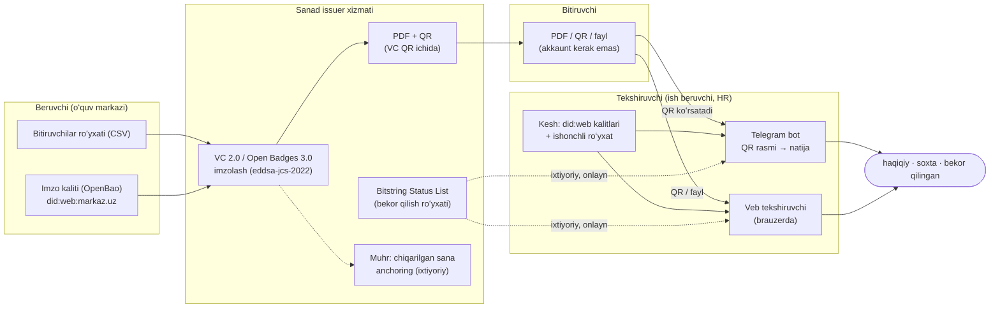

# Sanad: reja

> **Holat:** rejalashtirish, kod yoʻq · **Sana:** 2026-11-13 · **Manba:** Wonmor web3 REPORT.md §7.2, §8, §9 va [research/](research/)

## 1. Maqsadlar

1. Xususiy tashkilot (oʻquv markazi, IT kurs, tadbir) bergan sertifikatni **soxtalashtirishni befoyda qilish**: bitta harf oʻzgarsa, tekshiruv «soxta» deydi.
2. Tekshiruvni **saytga ishonchdan ajratish**: imzo beruvchining keshlangan kaliti bilan oflayn tekshiriladi.
3. Tekshirishni **hamma uchun oson** qilish: Telegram botga rasm yuborish yoki brauzerda ochish; oʻzbek (lotin), rus va ingliz tillarida.
4. Faqat **ochiq standartlar**: VC 2.0, Data Integrity, Bitstring Status List, Open Badges 3.0. Sertifikat Sanadsiz ham tekshiriladigan boʻlib qoladi.
5. Muhr bilan **umumiy yadro** (kalitlar, Merkle jurnal, anchoring).

## 2. Maqsad emas (non-goals)

- Davlat hujjatlari (diplom, ID, guvohnoma) chiqarish yoki ularga taqlid qilish.
- ZRU-793 maʼnosidagi ERI oʻrnini bosish yoki «ERIga teng» deb daʼvo qilish.
- Token, NFT, kripto toʻlov, blokcheynga yozish uchun pul toʻlash, kalit yoki aktivni boshqalar uchun saqlash.
- Odamning bilimini isbotlash: imzo faqat «kim berdi va oʻzgarmagan»ni isbotlaydi.
- MVP da mobil hamyon ilovasi (OpenID4VCI keyinroq).

## 3. Arxitektura

**Tekshirish tartibi:**
1. QR dan VC olinadi (QR ichida maʼlumotning oʻzi; sigʻmasa, VC fayli PDF ichiga biriktiriladi).
2. `proof` olib tashlanib, hujjat kanonik shaklga keltiriladi (`eddsa-jcs-2022` uchun JCS).
3. `verificationMethod` dagi DID keshdagi kalit bilan solishtiriladi; imzo Ed25519 bilan tekshiriladi.
4. Beruvchi DID ishonchli roʻyxatda bormi (oʻxshash nomli domen aldamasligi uchun).
5. Ixtiyoriy: Bitstring Status List dan bekor qilinganmi.
6. Natija va «nimani isbotlaydi / nimani isbotlamaydi» bloki.

**Stek (REPORT §7.2):** .NET 10 issuer API; walt.id identity (Apache-2.0, Docker REST) yoki brauzer uchun digitalbazaar/vc (BSD-3-Clause); did:web; Telegram bot QR rasmidan dekodlaydi; kalitlar OpenBao da; Muhr bilan umumiy anchoring.

**Bogʻliqliklar:** Muhr (kalit boshqaruvi, Merkle jurnal) Sanaddan oldin quriladi. Ketma-ketlik: Muhr 1–8 hafta → Sanad 9–16 hafta → Shaffof (REPORT §8).

## 4. MVP: 8 hafta (Sanad 1–8 haftasi = umumiy 9–16 hafta)

| Hafta | Natija | Tayyor boʻlish mezoni |
|---|---|---|
| 1 | Sxemalar: Open Badges 3.0 «Course completion» va «Contributor»; wonmor.io uchun did:web | Sxemalar `sanad-schemas` repoda, did.json domenda ochiladi |
| 2 | Issuer CLI: CSV → imzolangan VC lar; walt.id lokal Docker da | 10 qatorli CSV dan 10 ta tekshiriladigan VC |
| 3 | Veb tekshiruvchi: brauzerda, oflayn, «nimani isbotlaydi» bloki | Tarmoq oʻchiq holda tekshiruv ishlaydi |
| 4 | Telegram bot: QR rasmi → natija; uz, ru, en | Bot uch natijani ham toʻgʻri qaytaradi |
| 5 | PDF shablon: VC QR ichida, chop etishga tayyor | Chop etilgan qogʻozdan telefon bilan tekshiruv |
| 6 | Bekor qilish: Bitstring Status List; chiqarilgan sana Muhr bilan muhrlanadi | Bekor qilingan VC «bekor qilingan» deb chiqadi |
| 7 | Minimal issuer paneli: kalit rotatsiyasi, bekor qilish, eksport | Kalit almashgandan keyin eski VC lar ham tekshiriladi |
| 8 | Pilot: Wonmor ochiq repolari hissa qoʻshuvchilariga 10+ badge; research post; v0.1 | v0.1 reliz, post: *«A QR code is not a signature»* |

## 5. v1 va keyin

- **v1:** 1 ta tashqi oʻquv markazi bilan pilot; tashqi xavfsizlik koʻrigi; OpenID4VCI 1.0 orqali hamyonlarga chiqarish; issuer uchun hosting (somda yillik obuna); oʻrnatish va integratsiya xizmati. Tekshirish doim bepul.
- **Keyin:** SD-JWT (RFC 9901) bilan selective disclosure; EIMZO bilan qoʻshimcha imzo imkoniyatini oʻrganish; LMS integratsiyalari; dtwin (Growth), bitg (hissa badgeʼlari) va teletwin (lavozim VC si, ishdan ketganda bekor qilish) bilan bogʻlash (REPORT §7.2).

## 6. Birinchi pilot nomzodlari (turlari)

1. **Wonmorʼning oʻzi:** ochiq repolar hissa qoʻshuvchilariga badge (oʻz ishimizda sinash).
2. **Xususiy oʻquv markazlari va IT kurslar** (dasturlash, dizayn, til kurslari).
3. **Universitetlarning qoʻshimcha taʼlim kurslari va treninglari** (davlat diplomi emas).
4. **Hakaton, olimpiada va konferensiya tashkilotchilari.**
5. **Kompaniyalarning ichki oʻquv dasturlari** (xodim sertifikati).

Nomzodlar 10 ta intervyudan keyin tanlanadi (REPORT §9, 15-savol).

## 7. Muvaffaqiyat oʻlchovlari (REPORT §7.2)

| Oʻlchov | Maqsad |
|---|---|
| Faol issuerlar | 2 (Wonmor + 1 tashqi) |
| Chiqarilgan VC | 100 |
| Oflayn tekshirish vaqti | < 2 s |
| Tashqi xavfsizlik koʻrigi | kamida 1 kishi |
| Soxta QR testida aniqlash | 100% |

## 8. Xavflar va choralar

| Xavf | Taʼsir | Chora |
|---|---|---|
| Issuer kaliti oʻgʻirlanishi | Soxta, lekin «haqiqiy» koʻrinadigan sertifikatlar | Kalit OpenBao da; rotatsiya; status list; chiqarilgan sana Muhr bilan muhrlanadi |
| Oʻxshash domen bilan soxta issuer | Tekshiruvchi aldanadi | Ishonchli issuerlar roʻyxati; botda DID va domen aniq koʻrsatiladi |
| Issuerlar qiziqmasligi | Pilot boʻlmaydi | Avval oʻz badgeʼlarimiz; 10 ta intervyu; bepul tekshiruv |
| Standartlar murakkabligi | Kechikish | MVP da faqat VC 2.0 + OB 3.0 + `eddsa-jcs-2022`; boshqa formatlar keyin |
| QR sigʻimi | VC QR ga sigʻmaydi | Minimal maydon; sigʻmasa VC PDF ga biriktiriladi, QR da xesh |
| Shaxsiy maʼlumotlar talablari | Huquqiy xavf | Minimal maydon, maʼlumot holderda, server Oʻzbekistonda; yurist javobi ([legal.md](research/legal.md)) |
| Davlat hujjatiga taqlid deb topilishi | Huquqiy xavf | Shablonlarda gerb va «diplom» yoʻq; faqat xususiy issuerlar |
| Muhr kechikishi | Sanad boshlanmaydi | Sanad MVP Muhrsiz ham ishlaydi; anchoring ixtiyoriy |

## 9. Ochiq savollar

1. Yuristga savollar: [research/legal.md §8](research/legal.md).
2. QR ga VC toʻliq sigʻadimi yoki faqat havola + xesh? (prototip bilan oʻlchash)
3. `eddsa-jcs-2022` mi yoki `eddsa-rdfc-2022` mi? JCS soddaroq, lekin OB 3.0 tekshiruvchilari qaysi birini kutadi?
4. Bot QR ni rasmdan oʻqishda past sifatli suratlar bilan qanchalik ishonchli?
5. Ishonchli issuerlar roʻyxatini kim yuritadi va qanday yangilanadi?
6. Xususiy sertifikatlarga talab: 10 ta intervyu (oʻquv markazlari, HR).
7. EIMZO algoritmlari uchun ochiq tekshirish kutubxonasi bormi? (REPORT §9, 13-savol)
